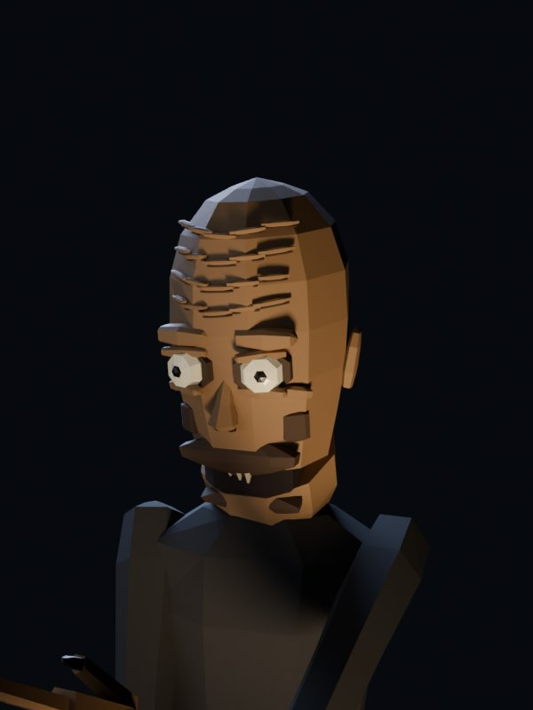
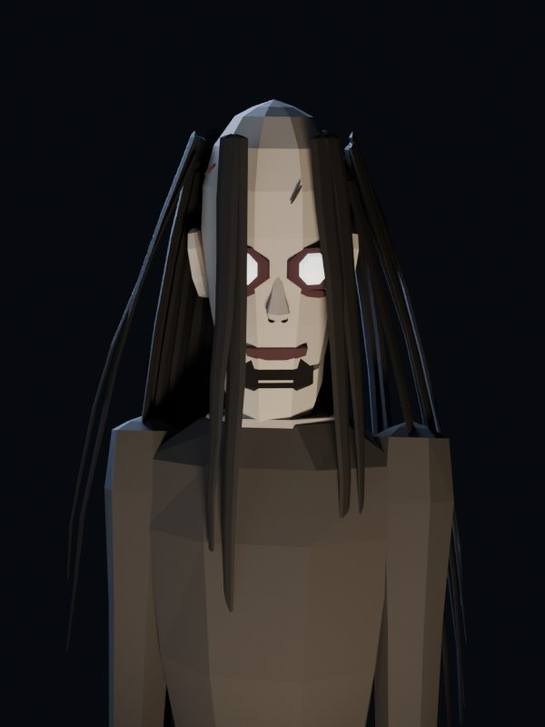
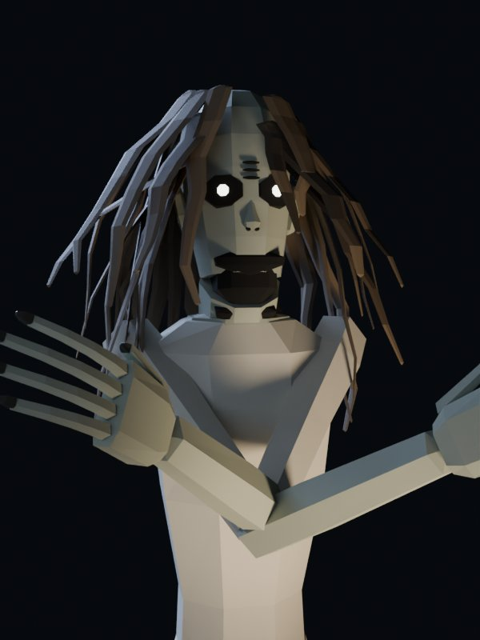
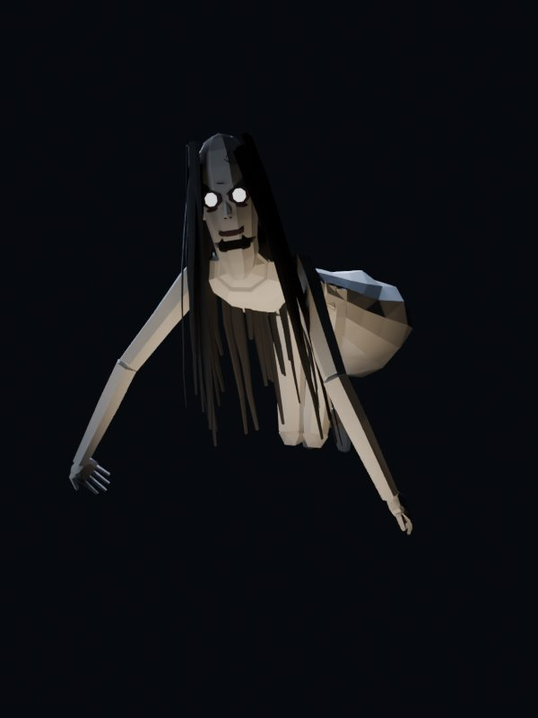

# ОНИ ЗДЕСЬ — AR-хоррор в браузере телефона

Сайт открывает заднюю камеру телефона, и в твоей комнате начинает бродить невидимый
призрак. Механика — как в AR-хоррорах с аниматрониками: слушай шаги, найди существо
фонарём по помехам, выдержи его взгляд и ударь шокером в последний момент перед рывком.
Вместо аниматроников здесь четыре человекоподобных монстра, смоделированных в Blender.

| Соглядатай | Бледная | Крикунья | Ползущая |
|---|---|---|---|
|  |  |  |  |

## Как запустить на телефоне

Камера в браузере работает только по **HTTPS**, поэтому проще всего включить GitHub Pages:

1. На GitHub: **Settings → Pages → Build and deployment → Deploy from a branch**.
2. Выбери ветку с этими файлами и папку `/ (root)`, нажми **Save**.
3. Через минуту сайт будет доступен по адресу `https://<логин>.github.io/horror/` — открой его на телефоне.

Локально (на компьютере, без гироскопа — осмотр мышью):

```bash
python3 -m http.server 8000
```

и открой `http://localhost:8000`.

## Как играть

1. Встань посреди комнаты, держи телефон перед собой и поворачивайся всем телом — сцена
   привязана к гироскопу (на iPhone нужно разрешить «Движение и ориентация»).
2. **Слушай шаги** — в наушниках слышно, с какой стороны ходит существо.
3. Когда оно затаится, в его стороне пойдут **помехи и вибрация**. Включи фонарь, наведи прицел
   и держи, пока не заполнится шкала сигнала.
4. Обнаруженное, оно смотрит на тебя… и бросается. Жми **«Шокер»**, когда оно уже совсем рядом.
   Рано — промах, а шокеру нужно ~3 секунды на заряд.
5. Фонарь садит батарею. Не нашёл существо вовремя — оно нападёт само.

Три уровня сложности: «Тихая» (3 атаки, подсказка для шокера), «Тёмная» (4), «Кошмар» (6).
На Android-Chrome игра может включать настоящий фонарик телефона.
На компьютере: мышь/стрелки — осмотр, **F** — фонарь, **Пробел** — шокер. `?debug` в адресе показывает отладку.

## Устройство проекта

```
index.html            экраны: меню, правила, HUD, финал
css/style.css         оформление и HUD
js/main.js            сцена Three.js, камера, ИИ монстра (бродит → затаился → смотрит → рывок)
js/monster.js         загрузка glTF, шейдер «помех»-маскировки, процедурная анимация суставов
js/look.js            гироскоп (deviceorientation) или перетаскивание
js/audio.js           все звуки синтезируются Web Audio: шаги, дыхание, сердце, визг, скример, шокер
models/*.glb          модели монстров (экспорт из Blender)
img/*.jpg             превью-рендеры (Cycles)
blender/build_monsters.py  скрипт, который строит модели и рендерит превью
vendor/three          Three.js r170 (MIT)
```

## Модели и Blender

Все монстры собираются скриптом `blender/build_monsters.py` — его можно перезапустить и
поправить параметры (рост, длина пальцев, размер головы, количество прядей, цвета материалов):

```bash
blender -b -P blender/build_monsters.py
```

(или `python blender/build_monsters.py` с модулем `bpy` из PyPI для Python 3.11).
Флаг `--no-render` пропускает рендер превью; можно указать конкретного монстра: `-- pale`.

Правила стиля, которым следуют модели:

- **Ни одной сферы и плавной кривой.** Голова, конечности, глаза, зубы и пряди — это лофты
  из многоугольных сечений (3–14 граней) с плоским затенением: округлости переданы угловыми пластинами.
- **Ни одного острого угла и тупого среза.** Каждая деталь кончается скошенной «вырезанной»
  шапкой (фаска + низкая пирамида), коробки строятся с сечением «квадрат со срезанными углами»,
  когти и зубы сужаются в усечённый клин, подол платья — рваный, а не обрезанный.

Каждая модель — иерархия суставов (`Hips → Spine → Neck → Head → Jaw`, руки, ноги), которую
сайт анимирует по именам: походка, дёрганые повороты головы, открывание пасти, рывок, судороги от шокера.
